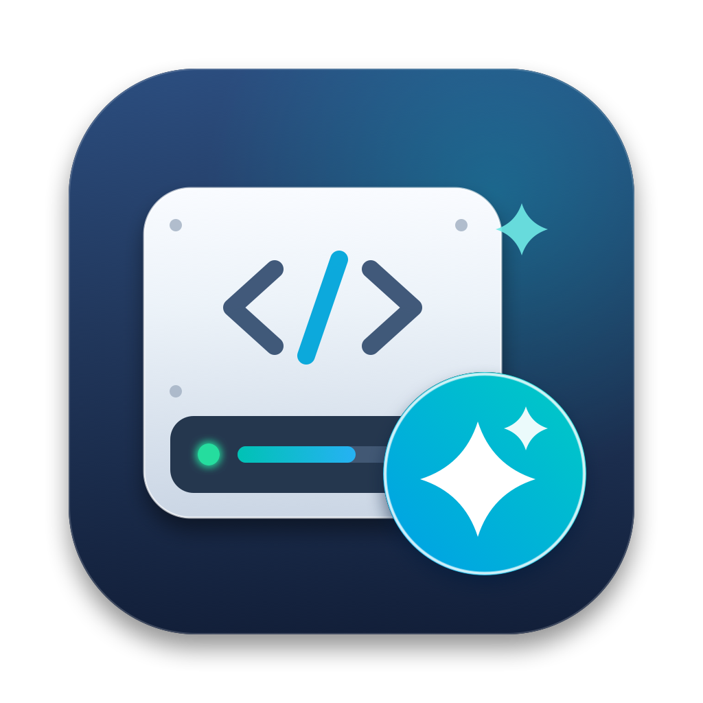

  

<h1 align="center">DevCleaner</h1>

  A native macOS utility for safely finding and cleaning developer storage left behind by Xcode, iOS simulators, Android tooling, Gradle, npm, Docker, Claude, Codex and other development tools.

## Why DevCleaner

Mobile and AI-assisted development can quietly consume tens of gigabytes through simulator data, build artifacts, package caches, runtime bundles and local models. DevCleaner makes that storage visible and lets you clean it from one native SwiftUI interface without touching your source code.

The project was designed around one rule: **safety is more important than maximum cleanup**.

## What it scans

DevCleaner can inspect and classify storage used by:

- **Project Storage Analyzer** (`~/Developer` or custom directory): per-project breakdown of regenerable caches (`.next`, `.expo`, `.turbo`, `.metro`, verified `.cache/npm`, `.cache/pnpm`, `.cache/corepack`), build outputs (`.build`, verified Android Gradle `build`, verified local Xcode `DerivedData` and `SYMROOT`), dependencies (`node_modules`, `ios/Pods`), `.xcresult` bundles, worktrees, and protected project files
- **Git & Claude Worktree Analyzer** (read-only informative mode): inspects linked Git worktrees, `.claude/worktrees`, and `~/.codex/worktrees` via `git worktree list --porcelain` and `git status --porcelain --branch`
- Xcode DerivedData, logs and application caches
- iOS / watchOS simulator devices (grouped by runtime version, with installed app detection and **Favorites** protection) and unavailable simulators
- Android SDK, NDK, system images, AVD virtual devices (with live PID lock verification), and temporary caches
- Gradle caches
- npm caches and temporary npx packages
- CocoaPods and Swift Package Manager caches
- Homebrew downloads
- Docker data and build caches
- Claude caches, superseded `claude-code` tool versions, simulator builds and VM bundles (while strictly protecting sessions and configurations)
- Codex caches and runtimes (`codex-primary-runtime` and staged `codex-runtime-install-*`)
- Google local AI models and model caches
- Other known developer caches

## Safety levels

| Level | Meaning |
| --- | --- |
| **SAFE** | Regenerable cache/build data that can be cleaned automatically |
| **REVIEW** | Usually regenerable, but may cause a large re-download, rebuild, or loss of simulator-local state |
| **CAUTION** | Potentially significant data such as Docker volumes; requires explicit confirmation |
| **NEVER DELETE** | Protected source, credentials, sessions, mounted runtimes, or system-managed data |

## Important protections

DevCleaner uses an explicit allow-list and performs safety validation again immediately before cleanup.

It is designed to never automatically delete source repositories, Git metadata, environment files, SSH keys, Keychains, cloud/Firebase credentials, Documents, Desktop, Photos, Mail, iCloud documents, CoreDevice DeviceFS, mounted CoreSimulator runtime volumes, Docker.raw directly, or Claude/Codex session and configuration data.

It also protects against parent-path traversal and symlink escapes.

## Simulator safety

Individual simulators are deleted through Apple's official xcrun simctl delete command.

- A **Booted** simulator is protected.
- A **Shutdown** simulator can be deleted even if a different simulator is currently running.
- The target simulator state is re-checked immediately before deletion.
- Simulator runtimes are kept separate from simulator devices and are protected by default.

Deleting a simulator removes its apps and simulator-local data. It does **not** delete your Xcode project or source code.

## Storage metrics

DevCleaner intentionally shows two different storage values:

- **macOS Available** — capacity macOS says can be made available for important usage; this can include purgeable storage.
- **Physical Free** — SSD capacity that is physically free right now.

## Cleanup workflow

1. Click **Scan Now**.
2. Use **Recommended Cleanup (SAFE Only)** for a conservative cleanup.
3. Optionally use **Development Cleanup** with an age filter such as 7 or 30 days.
4. Review the exact cleanup plan.
5. Confirm only the items you want to process.
6. SAFE file caches are normally moved to the macOS Trash.
7. Official system commands such as simctl are used for simulator deletion.

DevCleaner keeps a local cleanup history and distinguishes data moved to Trash from direct deletion.

## Requirements

- macOS 14 or later
- Swift 5.9+ to build from source
- The downloadable app release is built for Apple Silicon Macs

## Build from source

    git clone https://github.com/Ernestocanada/DevCleaner.git
    cd DevCleaner
    swift build
    swift test

The project is native Swift / SwiftUI and does not require Electron or a cloud backend.

## Restore DevCleaner after deleting it

The easiest recovery method is the GitHub **Releases** page.

1. Open the latest DevCleaner release.
2. Download DevCleaner-macOS-arm64.zip.
3. Unzip it.
4. Move DevCleaner.app to Applications or another location you prefer.
5. On first launch after downloading, macOS may require **right-click → Open** because this personal build is not notarized for public distribution.

You can always rebuild the app from the source repository as well.

## Privacy

DevCleaner works locally.

- No account
- No cloud backend
- No telemetry
- No upload of scanned file data

## Current status

This repository contains the tested local version of DevCleaner. The safety suite covers cleanup planning, protected paths, age filtering, simulator state re-validation, Docker protections, Claude/Codex protections, credential detection, symlink traversal and storage metric behavior.
